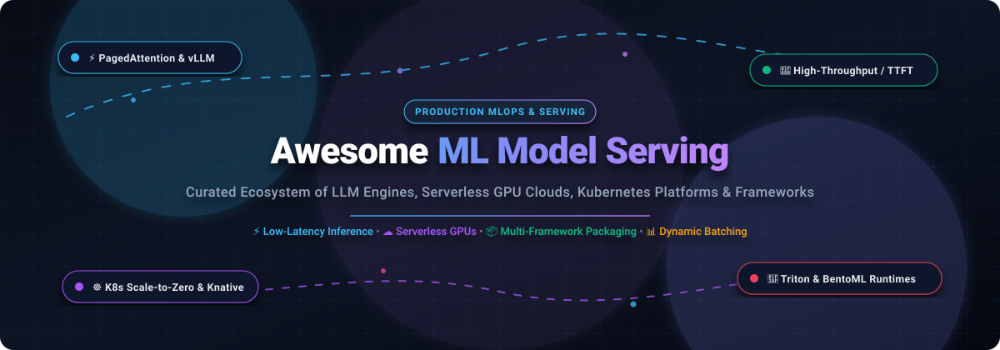

# 🚀 Awesome ML Model Serving

    

**A curated, production-grade directory of SaaS inference platforms, open-source model serving engines, serverless GPU clouds, and Kubernetes-native MLOps infrastructure.**

*Turn trained checkpoints into resilient, ultra-low latency API endpoints with dynamic batching, PagedAttention, KV-cache sharing, and scale-to-zero elasticity.*

[🌐 Sector Dynamics](#-sector-overview--market-dynamics) • [☁️ SaaS Platforms](#-saas--hosted-inference-platforms) • [🛠️ Open-Source Engines](#-open-source-github-projects) • [⚖️ Architecture Matrix](#-architectural-decision-matrix) • [🤝 Contributing](#-how-to-contribute) • [⭐ Star History](#-star-history)

---

## 📑 Table of Contents

- [📊 Sector Overview & Market Dynamics](#-sector-overview--market-dynamics)
- [☁️ SaaS & Hosted Inference Platforms](#-saas--hosted-inference-platforms)
- [🛠️ Open-Source GitHub Projects](#-open-source-github-projects)
- [⚖️ Architectural Decision Matrix](#-architectural-decision-matrix)
- [💡 Production Best Practices & Trade-offs](#-production-best-practices--trade-offs)
- [🤝 How to Contribute](#-how-to-contribute)
- [⭐ Star History](#-star-history)
- [💖 Support & Community](#-support--community)
- [📄 License & Disclaimer](#-license--disclaimer)

---

## 📊 Sector Overview & Market Dynamics

The global **AI inference and model serving infrastructure market** was valued at approximately **$12.8 Billion in 2024** and is projected to expand to over **$85 Billion by 2030**, compounding at a **CAGR exceeding 35%**. This rapid acceleration is fueled by enterprise transitions from one-time model training to continuous, 24/7 real-time production inference and agentic workflows.

The sector exhibits **moderate fragmentation** rather than a winner-take-all monopoly:
- **Hyperscalers (AWS, GCP, Azure)** dominate baseline compute reservations and enterprise compliance boundaries.
- **Serverless GPU Clouds (Modal, RunPod)** maintain deep technical moats around sub-second cold starts, Python-native developer ergonomics, and micro-billing.
- **Specialized LPU & High-Throughput Engines (Groq, Together AI, Fireworks AI)** capture latency-critical conversational applications through proprietary silicon and optimized inference kernels.
- **Self-Hosted Open-Source Frameworks (vLLM, SGLang, Triton, BentoML)** serve as the backbone for cost-conscious engineering teams managing predictable, high-volume baseline traffic on private infrastructure.

---

## ☁️ SaaS & Hosted Inference Platforms

The table below profiles top managed model serving platforms and serverless GPU clouds, sorted in descending order by **company valuation and market capitalization**.

| 🏢 Platform | 💰 Valuation / Size | 🏷️ Starting Tier Pricing | 🎁 Free Tier / Trial Limits | 🎯 Core Strengths & Best For |
| :--- | :--- | :--- | :--- | :--- |
| **[Modal](https://modal.com/)** | **~$15.75B Valuation** *(Raised $750M)* | **$0.000164/sec** (~$0.59/hr) for Nvidia T4 GPU; **$0.000014/core-sec** (~$0.05/core-hr) for CPU | **$30.00/month recurring compute credit** permanently on the Starter Plan; $0/mo platform fee | Python-native serverless containers, sub-second cold starts, scale-to-zero batch jobs, and GPU web endpoints. |
| **[Together AI](https://www.together.ai/)** | **~$8.3B Valuation** *(Raised $800M Series C)* | **$0.10 per 1M input tokens** / **$0.10 per 1M output tokens** (Llama 3.1 8B); Dedicated GPU clusters from **$1.00/hr** | **$15.00 initial prepaid deposit required** (No permanent free tier; Startup grant awards **$15k–$50k** in credits) | High-throughput open-weight LLM inference endpoints, custom fine-tuning, and dedicated multi-GPU clusters. |
| **[Groq](https://groq.com/)** | **~$6.9B Valuation** *(Raised $750M)* | **$0.05 per 1M input tokens** / **$0.08 per 1M output tokens** (Llama 3.1 8B); **$0.59 / $0.79 per 1M** (Llama 3.3 70B) | **Free Developer Tier** with no credit card required: capped at **30 RPM**, **14,400 requests/day**, and model token limits | Extreme low-latency, real-time generation powered by custom Language Processing Units (LPUs) exceeding 500 T/s. |
| **[Baseten](https://www.baseten.co/)** | **~$5.0B Valuation** *(Raised $300M+)* | Dedicated instances from **$0.40/hr** (Nvidia T4) / **$1.45/hr** (A10G); Serverless Model APIs from **$0.20 per 1M tokens** | **$30.00 one-time starter credits** upon workspace sign-up valid for a **30-day trial window**; $0/mo base plan | Production Truss packaging, declarative YAML deployments, scale-to-zero instances, and private VPC bridging. |
| **[RunPod](https://www.runpod.io/)** | **~$1.0B Valuation** *(Raised $100M Series A)* | Community Cloud GPUs from **$0.20/hr** (RTX 3070); Secure Cloud GPUs from **$0.69/hr** (RTX 4090); Serverless from **$0.0002/sec** | **$5.00 promotional starter credit** upon developer sign-up & phone validation (No permanent free tier; $0/mo base fee) | Highly cost-efficient serverless GPU workers, flexible on-demand compute pods, and scale-to-zero inference endpoints. |
| **[Fireworks AI](https://fireworks.ai/)** | **~$552M Valuation** *(Raised $52M Series B)* | Serverless inference from **$0.20 per 1M tokens** (Llama 3.1 8B); Dedicated GPU deployments from **$0.95/hr** | **$1.00 one-time starter credits** on initial registration (~1M–5M tokens free for testing; no permanent free tier) | Ultra-fast compound AI systems, sub-second speculative decoding, function calling, and structured JSON output. |
| **[Replicate](https://replicate.com/)** | **~$350M Valuation** *(Raised $40M Series B)* | **$0.000225/sec** (~$0.81/hr) for Nvidia T4 GPU; **$0.000010/sec** (~$0.036/hr) for CPU | Free interactive web playground predictions (~**50 demo runs** on signup); API usage requires a **$5.00 prepaid deposit** | One-click REST API deployment for open-source multimodal models (diffusion, whisper, vision) with zero DevOps overhead. |

---

## 🛠️ Open-Source GitHub Projects

The following open-source frameworks power modern self-hosted and cloud-native model serving. Sorted in strictly descending order by **GitHub Stars** ⭐.

### 1. 🦙 Ollama

* **Repository**: [`ollama/ollama`](https://github.com/ollama/ollama)
* **License**: MIT
* **Primary Focus**: Local & Edge LLM Serving, Desktop Daemon, OpenAI-Compatible REST API
* **Overview**: Ollama provides the smoothest developer workflow for running, customizing, and serving large language models locally across macOS, Linux, and Windows. It bundles model weights, configurations, and system prompts into unified `Modelfiles`.
* **Key Features**:
  - Exposes an OpenAI-compatible `/v1/chat/completions` HTTP server out of the box.
  - Native hardware acceleration across Apple Metal, NVIDIA CUDA, and AMD ROCm.
  - Automatic model quantization (GGUF 4-bit, 8-bit) and dynamic CPU/GPU memory offloading.
  - Built-in library of frontier open-weight models (`llama3`, `mistral`, `deepseek-r1`, `phi4`).
* **Best For**: Local developer prototyping, private on-prem edge deployments, and desktop AI agent backends.

---

### 2. ⚡ vLLM

* **Repository**: [`vllm-project/vllm`](https://github.com/vllm-project/vllm)
* **License**: Apache 2.0
* **Primary Focus**: High-Throughput LLM Inference Engine, PagedAttention Memory Management
* **Overview**: The gold standard for open-source LLM inference. vLLM pioneered **PagedAttention**, an algorithm that stores KV cache memory in non-contiguous virtual blocks, virtually eliminating memory fragmentation and boosting GPU utilization by 2–4x.
* **Key Features**:
  - **Continuous Batching & Chunked Prefill**: Maximizes GPU compute saturations under variable concurrent traffic.
  - **Extensive Quantization**: Native support for FP8, AWQ, GPTQ, AutoRound, INT8, and INT4.
  - **Broad Silicon Support**: NVIDIA (Ampere, Hopper, Blackwell), AMD ROCm, Intel Gaudi/CPUs, and Google TPUs.
  - **Advanced Decoding**: Built-in speculative decoding, prefix caching, multi-LoRA switching, and guided JSON generation.
* **Best For**: High-concurrency production LLM serving, enterprise chatbots, and cost-effective multi-GPU clusters.

---

### 3. 🧠 LocalAI

* **Repository**: [`mudler/LocalAI`](https://github.com/mudler/LocalAI)
* **License**: MIT
* **Primary Focus**: Self-Hosted Multimodal AI Middleware, Drop-in OpenAI Alternative
* **Overview**: LocalAI functions as a self-hosted, drop-in replacement for OpenAI, Claude, and ElevenLabs APIs. It runs on standard consumer hardware and CPUs without requiring dedicated GPUs.
* **Key Features**:
  - Unifies text generation, audio transcription (Whisper), text-to-speech, image generation, and vector embeddings under one API.
  - Multiple backend runtimes including llama.cpp, diffusers, piper, and ONNX.
  - Zero-dependency distribution available as lightweight Docker containers and Kubernetes Helm charts.
* **Best For**: Air-gapped environments, consumer hardware homelabs, and edge IoT devices.

---

### 4. 🌐 Ray Serve

* **Repository**: [`ray-project/ray`](https://github.com/ray-project/ray)
* **License**: Apache 2.0
* **Primary Focus**: Distributed Model Orchestration, Multi-Replica Gang Scheduling, Autoscaling
* **Overview**: Ray Serve is a scalable model serving library built on top of the Ray distributed compute framework. It manages complex pipelines composed of multiple models running across heterogeneous CPU and GPU clusters.
* **Key Features**:
  - Independent replica autoscaling with request batching and intelligent backpressure routing.
  - Composes natively with vLLM, TensorRT-LLM, and PyTorch for multi-node inference.
  - Multi-host TPU gang-scheduling via declarative accelerator topology configurations.
  - Dynamic traffic splitting, canary releases, and zero-downtime rolling model updates.
* **Best For**: Enterprise teams orchestrating complex multi-model pipelines (e.g., ASR + LLM + TTS) with dynamic autoscaling.

---

### 5. ⚡ SGLang

* **Repository**: [`sgl-project/sglang`](https://github.com/sgl-project/sglang)
* **License**: Apache 2.0
* **Primary Focus**: Structured Generation, RadixAttention Multi-Turn Cache Reuse, High-Speed LLM Serving
* **Overview**: SGLang is a super-fast serving engine and structured programming framework for LLMs and vision-language models. Its defining innovation is **RadixAttention**, which automatically retains and reuses KV caches across requests using a radix tree.
* **Key Features**:
  - RadixAttention accelerates multi-turn chat, chain-of-thought reasoning, and agent tool-calling by 3–5x.
  - Native regex and context-free grammar (CFG) constrained decoding for reliable structured JSON output.
  - High-performance fused attention kernels, FP8 quantization, and multi-GPU tensor parallelism.
  - Seamless support for leading Vision-Language Models (VLMs) like Qwen2-VL and LLaVA.
* **Best For**: AI agent workflows, compound reasoning loops, and applications requiring structured data extraction.

---

### 6. 📱 MLC-LLM

* **Repository**: [`mlc-ai/mlc-llm`](https://github.com/mlc-ai/mlc-llm)
* **License**: Apache 2.0
* **Primary Focus**: Universal Compiler-Based Serving, Cross-Platform Edge & WebGPU Deployment
* **Overview**: Machine Learning Compilation (MLC) brings universal, hardware-accelerated LLM inference to any operating system and device. Powered by Apache TVM Unity, it compiles models into native runtime kernels.
* **Key Features**:
  - Cross-platform binaries targeting WebGPU (browsers), iOS, Android, macOS Metal, Linux CUDA, and Windows Vulkan.
  - Python, C++, Swift, and Java SDK bindings for direct native app integration.
  - Highly optimized memory footprint suitable for mobile phones and resource-constrained edge gateways.
* **Best For**: On-device client inference, browser-based WebGPU apps, and cross-platform native software.

---

### 7. 🏎️ NVIDIA TensorRT-LLM

* **Repository**: [`NVIDIA/TensorRT-LLM`](https://github.com/NVIDIA/TensorRT-LLM)
* **License**: Apache 2.0
* **Primary Focus**: Peak NVIDIA Hardware Acceleration, In-Flight Batching, Kernel Fusions
* **Overview**: NVIDIA’s official enterprise inference compilation library. TensorRT-LLM extracts maximum tokens-per-second and lowest time-to-first-token (TTFT) across NVIDIA GPU architectures (Ampere, Ada Lovelace, Hopper, and Blackwell).
* **Key Features**:
  - Advanced in-flight request batching (continuous batching) and paged KV cache allocation.
  - Cutting-edge FP8 and NVFP4 quantization pipelines optimized for Hopper H100 and Blackwell B200 GPUs.
  - Deep tensor parallelism, pipeline parallelism, and custom GPU interconnect optimizations (NVLink/NVSwitch).
* **Best For**: Enterprises committed to NVIDIA hardware seeking maximum throughput and absolute minimum latency.

---

### 8. 🛡️ Triton Inference Server

* **Repository**: [`triton-inference-server/server`](https://github.com/triton-inference-server/server)
* **License**: BSD-3-Clause
* **Primary Focus**: Multi-Framework Enterprise Serving, Dynamic Batching, Concurrent Execution
* **Overview**: NVIDIA Triton is the enterprise standard for orchestrating multi-framework ML serving in production. It deploys heterogeneous models from PyTorch, TensorFlow, TensorRT, ONNX, and Python on shared compute infrastructure.
* **Key Features**:
  - **Multi-Runtime Engine**: Supports TensorRT, ONNX Runtime, OpenVINO, PyTorch LibTorch, and custom Python backends simultaneously.
  - **Model Ensemble Pipelines**: Seamlessly chains preprocessing, embedding generation, inference, and post-processing.
  - Concurrent model execution on shared GPUs with dynamic micro-batching and priority queues.
  - Production-grade telemetry via Prometheus metrics, OpenTelemetry tracing, and gRPC/HTTP endpoints.
* **Best For**: Enterprise MLOps teams managing large fleets of diverse ML models (computer vision, tabular, LLMs) on Kubernetes.

---

### 9. 🤗 Text Generation Inference (TGI)

* **Repository**: [`huggingface/text-generation-inference`](https://github.com/huggingface/text-generation-inference)
* **License**: Apache 2.0 / Open RAIL
* **Primary Focus**: Production LLM Serving, Hugging Face Hub Integration, Token Streaming
* **Overview**: Developed by Hugging Face, TGI powers Hugging Face Inference Endpoints. Written in Rust and Python, it delivers a secure, production-tested server for popular transformer models.
* **Key Features**:
  - Zero-configuration deployment for models hosted on the Hugging Face Hub.
  - Token streaming over Server-Sent Events (SSE) and OpenAI-compatible completions endpoints.
  - Integrated FlashAttention v2, Paged Attention, and continuous batching.
  - Built-in text watermarking, output tensor parallelism, and safety filters.
* **Best For**: Teams anchored in the Hugging Face ecosystem seeking immediate, turnkey open-source model serving.

---

### 10. 🔄 Xinference

* **Repository**: [`xorbitsai/inference`](https://github.com/xorbitsai/inference)
* **License**: Apache 2.0
* **Primary Focus**: Distributed Multimodal Inference, Unified Backend Abstraction
* **Overview**: Xinference is an all-in-one distributed inference platform that serves LLMs, embedding models, speech recognition, and image diffusion models. It seamlessly abstracts multiple backend engines.
* **Key Features**:
  - Multi-engine dispatch: automatically selects or lets you toggle between vLLM, llama.cpp, and Hugging Face backends.
  - Distributed cluster mode with worker health checking, automatic failover, and load balancing.
  - Complete OpenAI-compatible APIs for chat, completions, embeddings, transcriptions, and images.
* **Best For**: Self-hosted private clouds requiring a single platform for language, audio, and image models.

---

### 11. 🍱 BentoML

* **Repository**: [`bentoml/BentoML`](https://github.com/bentoml/BentoML)
* **License**: Apache 2.0
* **Primary Focus**: Model Packaging, Multi-Model Composition, Adaptive Micro-Batching
* **Overview**: BentoML bridges data science development and DevOps production deployment. It packages trained weights, Python source code, and environment dependencies into standardized deployment units called "Bentos".
* **Key Features**:
  - Adaptive micro-batching maximizes throughput without requiring manual tuning.
  - Single-command containerization (`bentoml containerize`) targeting Docker, Kubernetes, AWS ECS, and GCP Cloud Run.
  - Built-in OpenAPI / Swagger specification generation, Prometheus metrics, and distributed tracing.
  - Composes with vLLM and OpenLLM for state-of-the-art LLM inference.
* **Best For**: Data science and engineering teams looking for a structured, framework-agnostic deployment pipeline.

---

### 12. ☸️ KServe

* **Repository**: [`kserve/kserve`](https://github.com/kserve/kserve)
* **License**: Apache 2.0
* **Primary Focus**: Kubernetes-Native Inference, Declarative CRDs, Scale-to-Zero Elasticity
* **Overview**: Formerly known as KFServing, KServe is the Kubernetes-native serverless inference platform standard supported by the Linux Foundation. Built on Knative, Istio, and ModelMesh, it provides declarative CRDs (`InferenceService`) for model lifecycle management.
* **Key Features**:
  - **Serverless Autoscaling**: Scale-to-zero during idle periods to eliminate unnecessary cloud GPU expenditures.
  - **ModelMesh**: Dense packing of hundreds of smaller models onto shared pods to maximize cluster density.
  - Advanced traffic management: Canary deployments, A/B testing splits, and request payload transformations.
* **Best For**: Cloud-native teams with existing Kubernetes clusters seeking standardized, declarative model serving.

---

### 13. 🕸️ Seldon Core

* **Repository**: [`SeldonIO/seldon-core`](https://github.com/SeldonIO/seldon-core)
* **License**: Apache 2.0
* **Primary Focus**: Complex Inference Graphs, Multi-Armed Bandits, Explainability & Governance
* **Overview**: Seldon Core converts machine learning models into production microservices on Kubernetes. It is renowned for its expressive inference graph architecture, enabling dynamic chaining of models, routers, combiners, and explainers.
* **Key Features**:
  - Advanced routing patterns: Epsilon-greedy multi-armed bandits, canary rollouts, and shadow deployments.
  - Native integration with Alibi Explain for model interpretability and Alibi Detect for real-time drift detection.
  - Multi-protocol support: Seldon gRPC, v2 Data Plane standard, and RESTful HTTP.
* **Best For**: Highly regulated industries (finance, healthcare) requiring rigorous model auditing, drift detection, and routing.

---

### 14. 🚀 DeepSpeed-MII

* **Repository**: [`deepspeedai/DeepSpeed-MII`](https://github.com/deepspeedai/DeepSpeed-MII)
* **License**: Apache 2.0
* **Primary Focus**: Low-Latency Acceleration, Dynamic SplitFuse, Microsoft DeepSpeed Integration
* **Overview**: Developed by Microsoft, DeepSpeed Model Inference Interface (MII) is built on DeepSpeed-FastGen. It introduces Dynamic SplitFuse, a technique that fuses prompt processing and token generation across variable sequence lengths.
* **Key Features**:
  - Dynamic SplitFuse cuts generation latencies and stabilizes time-per-output-token (TPOT) under variable loads.
  - ZeRO-Inference memory optimizations allow models that exceed single-GPU VRAM to run efficiently across multi-GPU setups.
  - Up to 2x higher throughput compared to standard Hugging Face pipelines out of the box.
* **Best For**: Machine learning researchers and enterprise teams already utilizing Microsoft DeepSpeed for model training.

---

### 15. 📦 Truss

* **Repository**: [`basetenlabs/truss`](https://github.com/basetenlabs/truss)
* **License**: Apache 2.0
* **Primary Focus**: Containerized Model Packaging, Developer CLI, Portable Serving Microservices
* **Overview**: Truss is the open-source CLI created by Baseten to package machine learning models into production-ready containers. It bridges the gap between Python development notebooks and cloud deployments without requiring custom Dockerfiles.
* **Key Features**:
  - Model serving logic written in standard Python; Truss handles containerization, CUDA dependencies, and web servers.
  - Live reload capability for local rapid iterative development without rebuilding Docker images.
  - Engine-based deployments: configure vLLM, TensorRT-LLM, or SGLang simply with a declarative `config.yaml`.
  - Deployment artifacts are fully portable to self-hosted Docker, Kubernetes, or Baseten's managed cloud.
* **Best For**: ML engineers who want clean, portable model packaging without wrestling with Dockerfile syntax.

---

### 16. ⚙️ OpenVINO Model Server (OVMS)

* **Repository**: [`openvinotoolkit/model_server`](https://github.com/openvinotoolkit/model_server)
* **License**: Apache 2.0
* **Primary Focus**: Intel Hardware Acceleration (Xeon, Core Ultra, Arc, Gaudi), C++ High-Throughput Serving
* **Overview**: OpenVINO Model Server is a high-performance C++ inference server developed by Intel. Implementing both the KServe v2 Data Plane and Triton-compatible gRPC/REST APIs, it optimizes model execution specifically on Intel silicon.
* **Key Features**:
  - Leverages Intel Advanced Matrix Extensions (AMX) and AVX-512 for high-speed CPU-only inference.
  - Dynamic batching, multi-model execution, and DAG pipeline graphs for combined vision and audio processing.
  - Native integration with Intel Arc GPUs and Gaudi AI accelerators.
* **Best For**: Deployments on Intel Xeon data centers, edge gateways, and cost-effective CPU-only servers.

---

## ⚖️ Architectural Decision Matrix

Use the matrix below to choose the right framework for your workload, hardware, and operational constraints:

| Capability / Metric | ⚡ vLLM | ⚡ SGLang | 🏎️ TensorRT-LLM | 🛡️ Triton | 🦙 Ollama | 🍱 BentoML | ☸️ KServe |
| :--- | :---: | :---: | :---: | :---: | :---: | :---: | :---: |
| **Primary Domain** | LLM Serving | LLM & VLMs | Peak NVIDIA LLM | Enterprise Multi-Model | Local / Edge | Packaging & Pipeline | K8s Scale-to-Zero |
| **KV Cache Tech** | PagedAttention | RadixAttention | Paged KV | Depends on Backend | GGUF Memory Map | Framework Dependent | Framework Dependent |
| **Batching Mechanism** | Continuous | Continuous | In-Flight | Dynamic Micro-Batch | Sequential / Simple | Adaptive Micro-Batch | Knative Concurrency |
| **Hardware Targets** | NVIDIA, AMD, TPU, Gaudi | NVIDIA, AMD | NVIDIA Only | NVIDIA, Intel, AMD | CPU, Metal, NVIDIA, ROCm | Hardware Agnostic | Hardware Agnostic |
| **Scale-to-Zero** | Pair with K8s/Ray | Pair with K8s/Ray | Pair with Triton/K8s | Pair with K8s | Native Desktop Daemon | Pair with Cloud Run/K8s | Native via Knative |
| **Multi-Model Pipeline** | Pair with Ray | Native (Radix) | Pair with Triton | Native Ensemble DAG | Modelfile Switch | Native Python DAG | Native InferenceGraph |
| **Setup Complexity** | Low-Moderate | Low-Moderate | High | High | Very Low | Low | Moderate-High |

---

## 💡 Production Best Practices & Trade-offs

1. **Self-Hosting vs. Serverless GPU Economics**:
   - Hosted serverless APIs (Modal, Together AI, RunPod) beat self-hosted infrastructure at variable, sporadic, or early-stage traffic where GPUs sit idle >60% of the time.
   - Self-hosting (vLLM or SGLang on reserved GPU instances) becomes dramatically cheaper once cluster utilization consistently exceeds **65–70% sustained capacity**.

2. **Single-Model vs. Compound Pipelines**:
   - For single LLM endpoints, dedicated engines like **vLLM** or **SGLang** deliver superior tokens-per-second and simpler operations.
   - For compound multi-modal pipelines (e.g., Audio Transcription $\to$ Text Reranking $\to$ LLM Generation $\to$ TTS), orchestrate using **Triton Model Ensembles** or **Ray Serve Deployments**.

3. **Cold-Start Latency Management**:
   - Kubernetes scale-to-zero saves cloud costs during idle periods, but large LLM checkpoints (70B+ parameters) require 30–90 seconds to pull and load into VRAM.
   - Mitigate cold starts using high-speed distributed container registries, pre-warmed PVC caches, or hybrid minimum-replica configurations.

---

## 🤝 How to Contribute

Contributions are welcome! Please follow these steps to add or update projects:

1. **Fork** this repository.
2. Edit [`README.md`](README.md) following the established table and markdown formatting.
3. Ensure pricing, valuations, and star counts are factual, verified, and up to date.
4. Open a **Pull Request** with a descriptive summary of your additions.

Check out our [Contributing Guidelines](.github/CONTRIBUTING.md) for details on code style and criteria.

---

## ⭐ Star History

---

## 💖 Support & Community

Thank you for visiting **Awesome ML Model Serving**! 🚀

If this curated repository helped you optimize, benchmark, or deploy your machine learning infrastructure, please consider supporting the project:

- ⭐ **Star this repository** on GitHub to help other engineers discover it.
- 🍴 **Fork the repo** and contribute benchmarks, architecture tips, and new serving engines.
- 📢 **Share with your team** and developer communities on LinkedIn, X/Twitter, and Reddit.
- ☕ **Sponsor the maintainer** or buy a coffee via the [GitHub Sponsors Dashboard](https://github.com/sponsors/ishandutta2007).

---

## 📄 License & Disclaimer

- Distributed under the [MIT License](LICENSE).
- This is a community-curated directory for engineering evaluation. All product trademarks, logos, and brand names are property of their respective owners.
